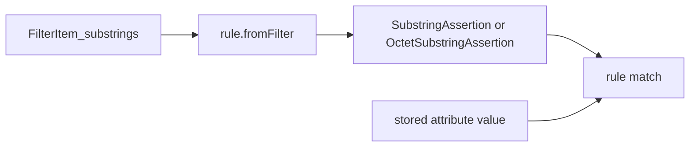

# Substring assertions as equality-style rules

Substring filters are not applied one `initial` / `any` / `final` fragment at a time. X.511 and RFC 4517 treat the whole `FilterItem_substrings` as something that is first converted into the substrings rule’s assertion value (`SubstringAssertion` or `OctetSubstringAssertion`). That assertion is then matched against the stored value the same way an equality assertion is: one call, both sides encoded or already decoded.

Today [`SubstringsMatcher`](packages/x500/src/lib/types/SubstringsMatcher.mts) still takes a `SubstringSelection`, and [`evaluateSubstring`](packages/x500/src/lib/utils/evaluateFilter.mts) calls the matcher once per fragment. Independent `indexOf` searches also let `any "abc"` plus `any "bcd"` match `"abcd"`. Those pieces must be consumed left to right with no overlap, so they match `"abcbcd"` and not `"abcd"`.

`storedPrefixMatch` is not one of these rules (its syntax is `UnboundedDirectoryString`). `generalWordMatch` stays an information object only. X.400 message-store substring rules are out of scope.

## Assertion syntaxes stay arrays

[`SubstringAssertion`](packages/x500/src/lib/modules/SelectedAttributeTypes/SubstringAssertion.ta.mts) and [`OctetSubstringAssertion`](packages/x500/src/lib/modules/SelectedAttributeTypes/OctetSubstringAssertion.ta.mts) are `SEQUENCE OF` aliases for arrays. Leave those generated types, their decoders, and their encoders as they are. Do not wrap them in classes or hang methods on them.

Conversion and evaluation are ordinary functions in [`packages/x500/src/lib/matching/substring/`](packages/x500/src/lib/matching/substring/). A shared `substringAssertionFromFilter(item, readComponent)` builds the `SubstringAssertion` array for the directory-string rules. `octetSubstringAssertionFromFilter` does the same for `OctetSubstringAssertion`.

## Two functions per rule, each match split outer and inner

Follow the same shape as [`caseIgnoreMatch`](packages/x500/src/lib/matching/equality/caseIgnoreMatch.mts) and `caseIgnoreMatchTyped`. The outer function accepts every representation a caller might already hold. It only reads those arguments into one concrete type and calls the inner function. The inner function’s parameters are monomorphic so V8 can optimize it. String preparation stays inside the inner function, as it does for equality.

Each file under `matching/substring/` exports:

1. `*FromFilter(item: FilterItem_substrings)` — transcode attribute-syntax fragments into the assertion array (`SubstringAssertion` or `OctetSubstringAssertion`). `initial` must be the first component, `final` the last, at most one of each. `control` is copied through and ignored by these rules (only `generalWordMatch` interprets it). An empty sequence, a duplicate anchor, a trailing `control` after `final`, an unrecognized extension, or a component that will not decode returns `undefined` so the filter is Undefined rather than a match-all.
2. `*Match(assertion, value)` — the polymorphic outer evaluator. `assertion` may be an `ASN1Element` or the decoded assertion array. `value` may be an `ASN1Element`, the decoded attribute type, or the native value that type already is. Attach `fromFilter` onto this function so [`getSubstringsMatcher`](packages/x500/src/lib/utils/evaluateFilter.mts) still returns one value. [`SubstringsMatcher`](packages/x500/src/lib/types/SubstringsMatcher.mts) becomes that two-argument function plus `fromFilter`. Extensible match already passes `matchValue` in assertion syntax, so it only calls the function.
3. `*MatchTyped(assertion, value)` — the monomorphic inner evaluator. Both arguments are the immediately useful types, never an element or a CHOICE:
   - Directory-string rules (`caseIgnore`, `caseExact`): prepared-piece array of strings, and a `string`.
   - `caseIgnoreIA5`, `numericString`, `telephoneNumber`: the same, after the outer function has read the stored value to a `string`.
   - `facsimileNumber`: pieces plus the telephone-number `string` (the outer function extracts it from an element, a `FacsimileTelephoneNumber`, or a `string`).
   - `caseIgnoreList`: pieces plus `readonly string[]` (one string per stored line).
   - `octetString`: octet pieces plus a `Uint8Array`.

Outer value types, by rule:

- Directory-string rules: `ASN1Element | UnboundedDirectoryString | DirectoryString | string`, using the existing `DirectoryStringInput` reader.
- IA5, numeric, and telephone: `ASN1Element | string`.
- Facsimile: `ASN1Element | FacsimileTelephoneNumber | string`.
- Case-ignore list: `ASN1Element | PostalAddress | CaseIgnoreList | readonly (UnboundedDirectoryString | string)[]`, using `readDirectoryStringList`.
- Octet string: `ASN1Element | Uint8Array`.

Component transcoding:

- case-ignore, case-exact, and case-ignore-list: `UnboundedDirectoryString`. A postal-address component that is a one-line `SEQUENCE OF` contributes that line; more than one line is Undefined, because one assertion piece is one string.
- numeric string: `NumericString` to `{ printableString }`
- telephone number: `PrintableString` to `{ printableString }`
- IA5: `IA5String` to `{ uTF8String }`
- facsimile: `FacsimileTelephoneNumber.telephoneNumber` (bare `TelephoneNumber` accepted), parameters dropped
- octet string: each component is an `OCTET STRING` inside `OctetSubstringAssertion`

## Ordered non-overlapping match

One shared scanner, used after each rule’s string preparation:

- Prepare the stored value once, and each assertion piece once, with the same preparation as the corresponding equality rule: `prepString` (case-fold only for the ignore rules) for directory and IA5 strings; strip all spaces for numeric strings; strip spaces and hyphens for telephone and facsimile numbers. Preparation failure or an empty prepared value or piece is a non-match. Empty pieces are rejected so `indexOf("")` cannot spin.
- `initial`, if present, must be a prefix; the cursor then moves past it.
- Each `any` is the earliest `indexOf` at or after the cursor; the cursor moves to the end of that match. `"abc"` then `"bcd"` matches `"abcbcd"` and fails on `"abcd"`.
- `final` must be a suffix whose start is at or after the cursor.
- `caseIgnoreListSubstringsMatch` uses the same cursor, but each piece must lie entirely inside one prepared line (concatenation with no separator, and no piece may cross a boundary). `initial` is a prefix of the first line; `final` is a suffix of the last line.

`evaluateSubstring` calls `fromFilter` once, then `match` once per stored value. An absent converter or an `undefined` assertion yields Undefined. Drop [`SubstringSelection`](packages/x500/src/lib/types/SubstringSelection.mts) and its export from [`packages/x500/src/index.mts`](packages/x500/src/index.mts) and the substring section of [`packages/x500/README.md`](packages/x500/README.md).

## LDAP

[`packages/ldap`](packages/ldap) has its own `SubstringSelection` and still invokes the matcher once per fragment in [`evaluateFilter`](packages/ldap/src/lib/evaluateFilter.mts). LDAP does not own the X.500 assertion types. Change its `SubstringsMatcher` to one call per stored value, passing the decoded pieces together (`initial`, `any[]`, `final`) plus the stored value, and delete the enum. Update [`evaluateFilter.spec.mts`](packages/ldap/src/test/evaluateFilter.spec.mts) and [`securityFixes.spec.mts`](packages/ldap/src/test/securityFixes.spec.mts).

## Tests

Extend the substring specs (and the X.500 filter spec’s UTF-8 substrings hook) to cover:

- outer calls with an encoded element, a decoded directory string, and a native `string` (or `Uint8Array` / string list for those rules), all reaching the same typed inner function
- `fromFilter` for directory string, numeric, telephone, facsimile, IA5, and octet components
- non-overlap and order (`abc`+`bcd` against `abcbcd` and `abcd`; `initial` consumed so a later `any` cannot reuse those characters)
- case-fold / space / hyphen preparation aligned with the equality rule
- list pieces that would cross a postal-address line
- empty assertion, empty piece, and a second `initial` not matching
